# Index des images — @DucSocialBot

## Captures de la conversation

### Dashboard d’agence (référence)

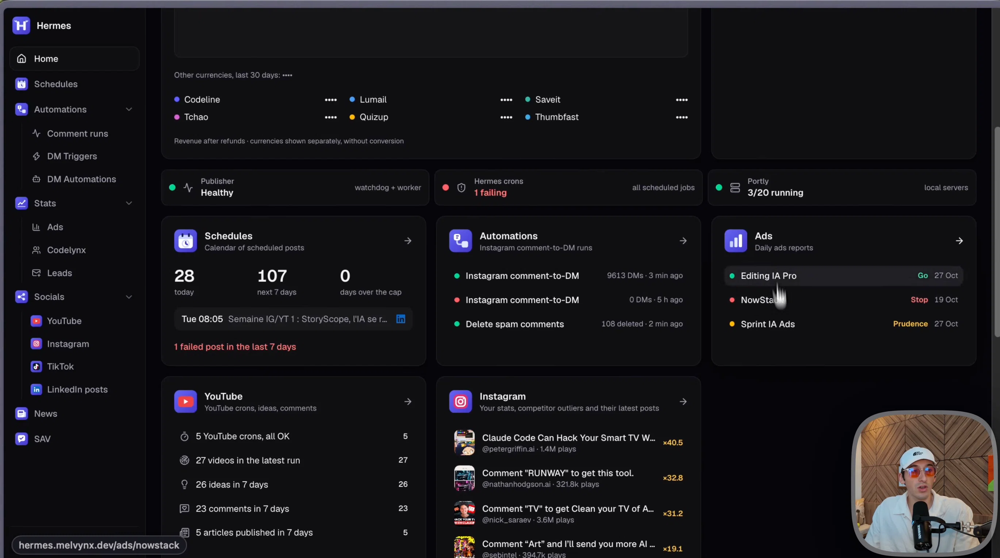

Schedules, Automations, Ads, YouTube, Instagram. Sert de référence visuelle, pas de modèle
à copier.

### Liste des skills génériques

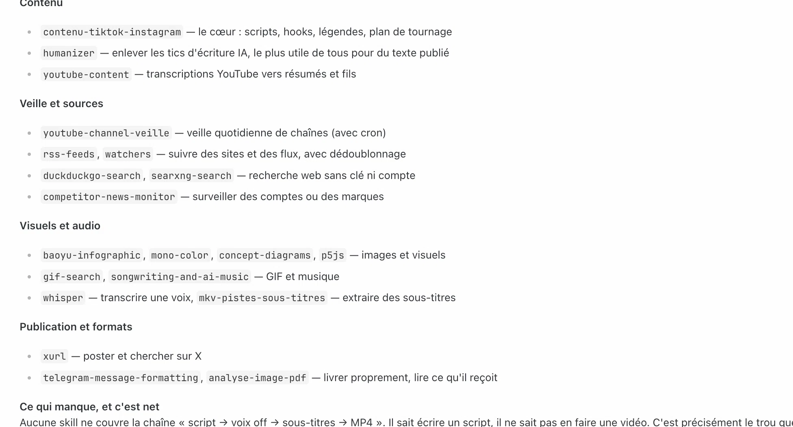

Montre que les skills « contenu, veille, visuels, publication » sont des skills génériques
installées, pas des skills propres au bot.

### Les trois niveaux

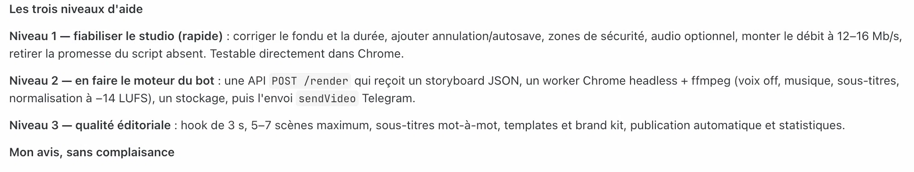

Plan : fiabiliser le studio, en faire le moteur du bot, qualité éditoriale.

### Sidebar Socials

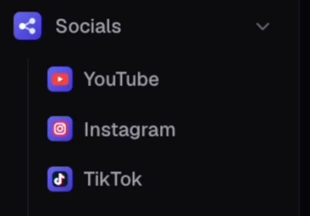

YouTube, Instagram, TikTok. Base des espaces plateformes du dashboard.

## Photos de profil

### Signal Robot

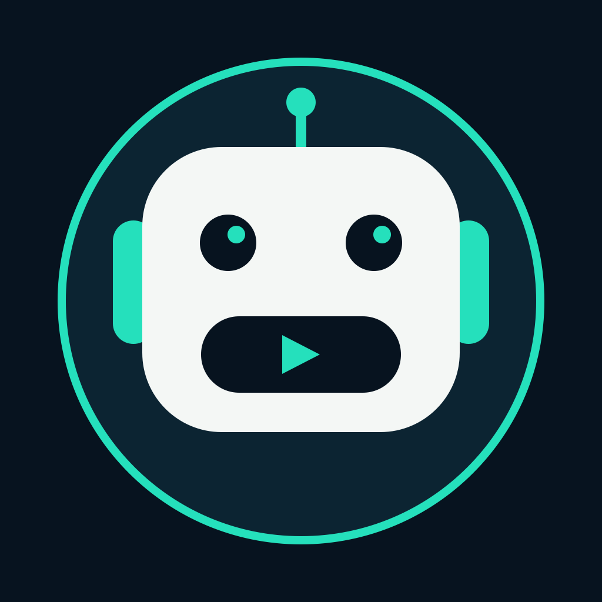

### Studio DS

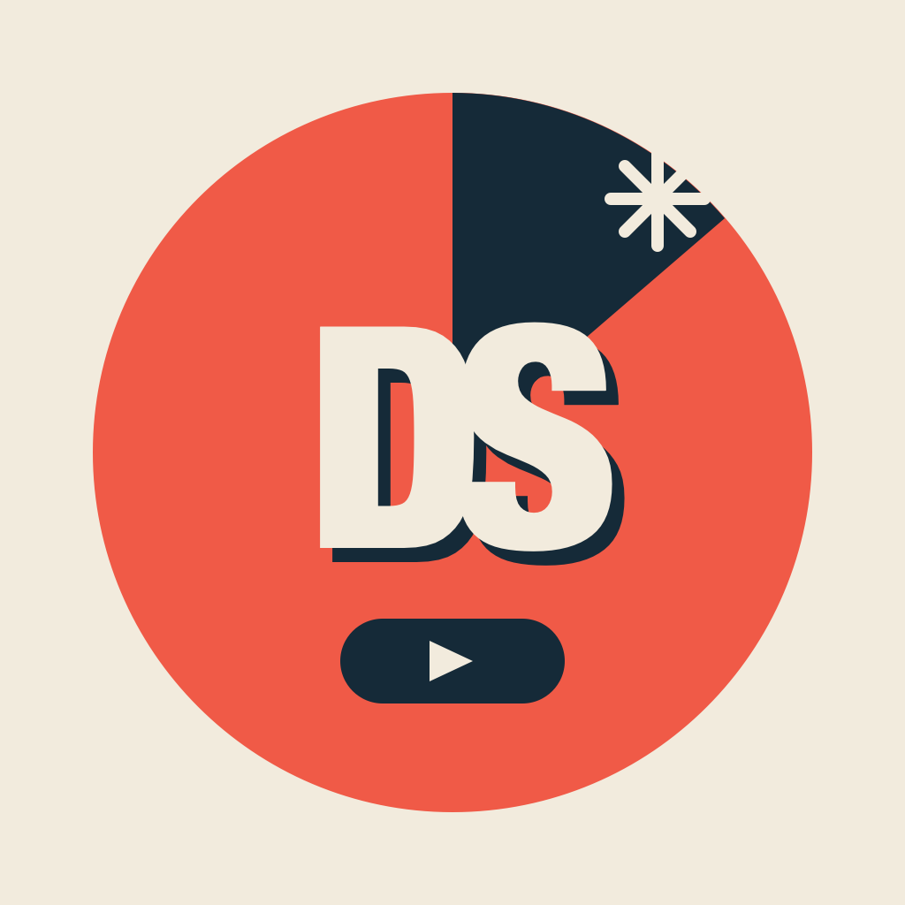

### Pulse Social

Les SVG sources sont dans le même dossier.

## Dashboard

### Maquette — vue d’ensemble

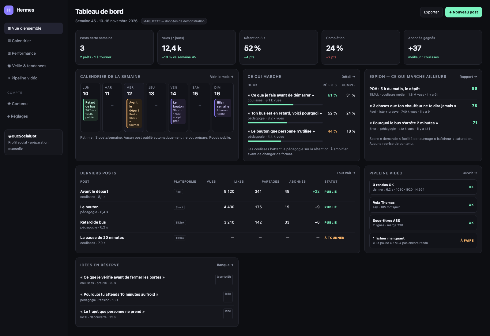

### Maquette — post-production

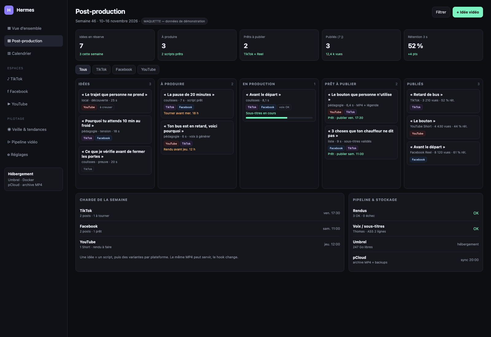

### Déployé — vue d’ensemble

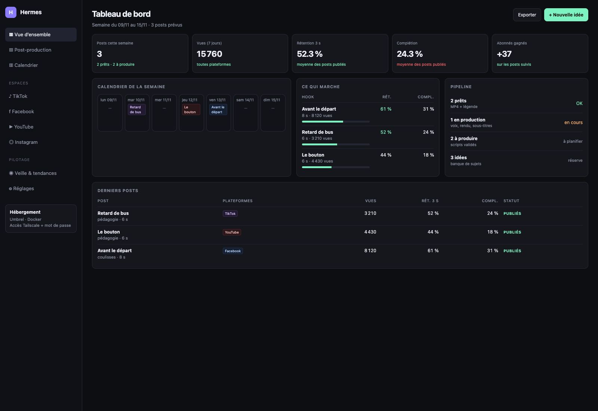

### Déployé — post-production

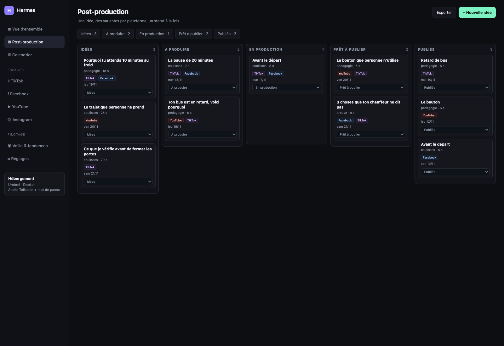

## Vidéo

### Frame du MP4 de démonstration

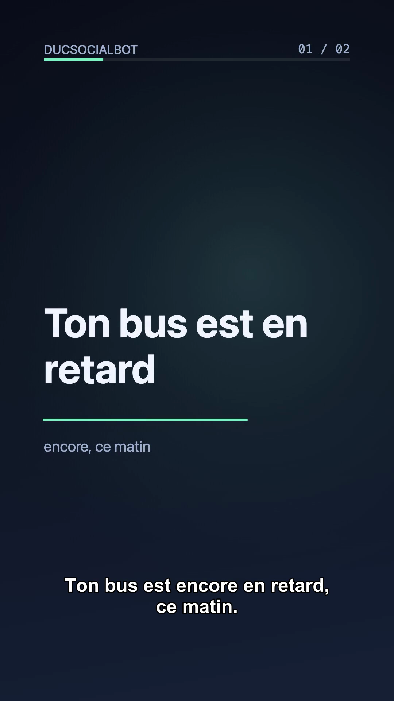

6,2 s, 1080×1920, voix `Thomas`, sous-titres ASS.
